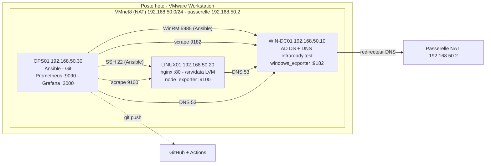

# Architecture

## Schema

## Roles des machines

| Machine  | Services                                   | Gere par                       |
|----------|--------------------------------------------|--------------------------------|
| WIN-DC01 | AD DS, DNS, partage `Commun`, windows_exporter | `playbooks/windows.yml` (role `windows_dc`) |
| LINUX01  | nginx, comptes Linux, LVM `/srv/data`, node_exporter, UFW | `playbooks/linux.yml` |
| OPS01    | Ansible, Prometheus, Grafana, node_exporter, UFW | `playbooks/linux.yml` + `playbooks/monitoring.yml` |

## Ressources des VM

| Machine  | vCPU | RAM | Disques              |
|----------|------|-----|----------------------|
| WIN-DC01 | 2    | 4 Go | 50 Go                |
| LINUX01  | 2    | 2 Go | 30 Go + 5 Go (donnees) |
| OPS01    | 2    | 4 Go | 50 Go                |

## Variante a 2 VM (poste limite en RAM)

Si le poste a 8 Go de RAM, LINUX01 et OPS01 sont fusionnes sur une seule VM Ubuntu
(192.168.50.20). Dans `inventory/hosts.yml`, mettre le meme hote dans `web` et `monitoring`,
et remplacer 192.168.50.30 par 192.168.50.20 dans `lab_controller_ip` et `monitoring/prometheus.yml`.
Limite : un incident sur ce serveur coupe aussi la supervision et l'outil d'administration.

## Etat reel des VM (releve du 08/11/2026)

| Machine  | Creee | Systeme installe | Remarque |
|----------|-------|------------------|----------|
| WIN-DC01 | oui   | Windows Server   | a preparer pour WinRM |
| LINUX01  | oui   | Ubuntu 24.04.5   | 2 vCPU, 2 Go, 30 Go + 5 Go, compte `infra` |
| OPS01    | oui   | Ubuntu 24.04.5   | 20 Go ; nom d'hote a corriger (`ops1` -> `ops01`) |
